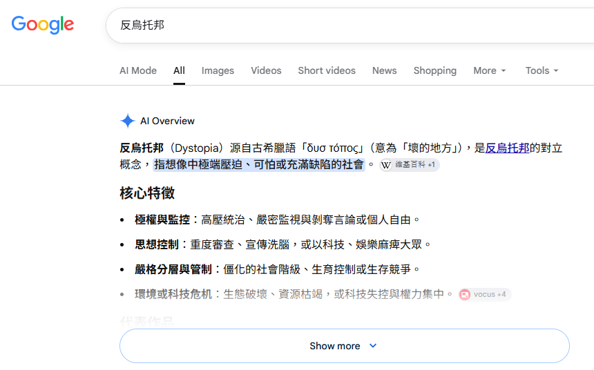

Wiwi 說過[兩](https://wiwi.blog/blog/google-ai-search-sucks)[次](https://wiwi.blog/blog/tchaikovsky-nicechord) Google AI 模式，然後我今天也來嘲笑了

你們知道「自己是自己對立面」是什麼嗎？

引用一句台詞：

> 抓捕周樹人，跟我魯迅有什麼關係？
>
> -- 中國電視劇《樓外樓》，2018

（btw我想找的是烏托邦 P 的[《反烏托邦》](https://music.youtube.com/watch?v=JtBCswnNAfk)。你沒看錯，我真的用 YT Music，但我用的是 [ArchiveTune](https://github.com/rukamori/ArchiveTune)）
