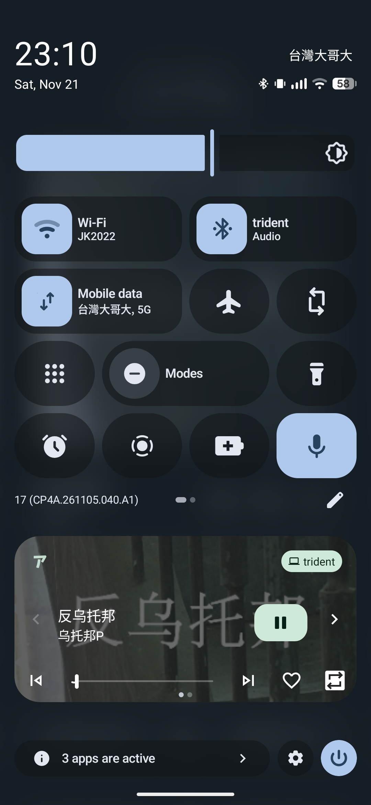
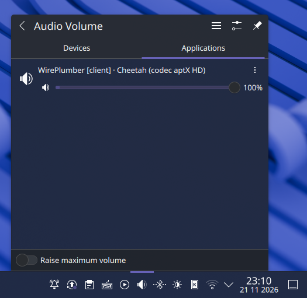

我的所有音樂清單都塞在手機的 ArchiveTune 裡，沒有同步出去[^1]，如果我要放音樂就得用耳機（不然我爸嫌吵）。但是我的耳機只能插一個裝置（有線耳機），又不是三頭六臂。

所以我問了 AI，有沒有辦法把手機音訊傳到電腦上？結果它告訴我，安裝 PipeWire 的 Linux 電腦居然可以直接透過藍芽取得手機音訊並播放！？

所以我試了一下，電腦真的被辨識成音訊裝置了！

然後我就能在電腦上放音樂清單了！耶！

<!-- 才發現 KDE 跟 GrapheneOS 截圖命名邏輯幾乎一樣 -->

（這才是 AI 正確用法，而不是人家比賽得獎的時候生成高飽和海報還忘記去水印）

<!-- 我說的就是我們學校 -->

[^1]: 要同步得登入 Google 帳號，但是我不想冒著被封的風險登入這些 clients 了
