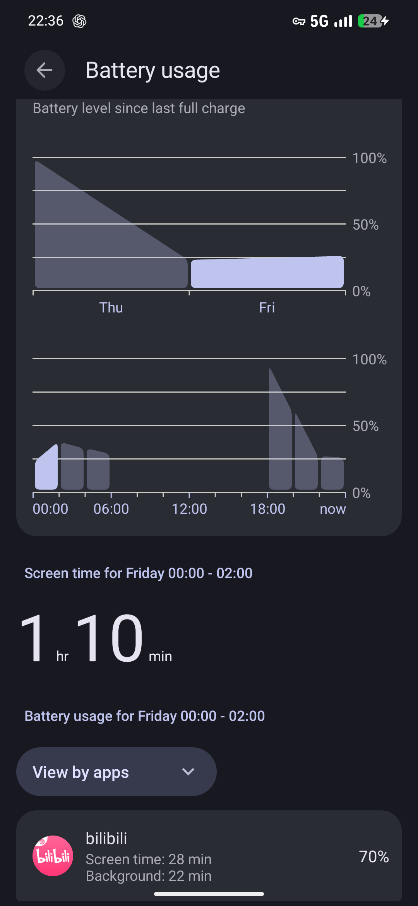

 > [!NOTE]
 > 截止撰寫本文，我還沒有開始任何動作。整理完畢後我會發布續篇。
 
這陣子我的狀況開始不對勁。

生理方面，目前知道的只有感冒，以及因此引發的腸胃炎。其實看上去已經好得差不多，但總感覺下一個階段要開始了——也就是發燒、咳嗽之類的。

課堂上我也越來越不專心。如果沒被老師盯，我甚至能放空一節課。

再加上作息不正常、不健康的飲食習慣（泡麵）、不愛喝水......

好吧，這下知道上述的主因了。

## 動力
其實這也讓我想到 Wiwi 的一篇文章：[《不喝酒好爽》](https://wiwi.blog/blog/no-alcohol)。當時他遇上了[「突發性耳聾」](https://nicechord.com/post/sudden-hearing-loss/)，因此開始改變自己的生活習慣。

何同學（[老師好我叫何同學](https://www.youtube.com/@hetongxue)）也是因為生病，加上 Tim Cook 的採訪要求才做出改變。

......

有個共同點，就是我們三個（我居然把自己跟兩個大前輩放一起比較）都會熬夜。這其中我最糟糕，因為我是純粹的玩不夠。

我手機沒有偵測螢幕時間，電池用量湊合看吧；我已經做好這篇文章發出去後被父母以及健教老師[^1]教訓的心裡準備了。

## 計畫
 * 每天晚上 11:30 以前上床
 * 把桌子整理好，丟垃圾（我爸摧我弄好久了 XDDDD）
 * 把東西分類收拾
 * 一天至少喝 1500 ml 水（我有時候一天才兩杯）
 * 睡前至少 15 分鐘不看螢幕
 * 晚餐盡量不要吃泡麵
 
當然，光靠說沒有用。這也是我放到部落格的原因，因為我可以放自己鴿子，但是我不敢放[一大堆人](https://niugnep.idv.tw/blog/why-you-write-this/#但是沒人看啊)鴿子。

## 明天再說
明天...或者後天吧，我會把我整理過的狀態放出來。

（真的有人想看嗎？）

[^1]: 腦抽把部落格連結寫學習單上了，不知道她會不會看。
