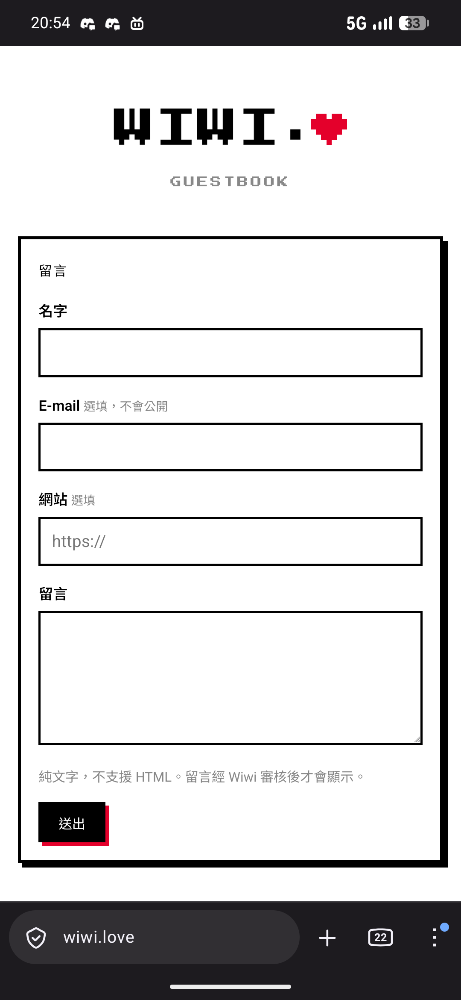
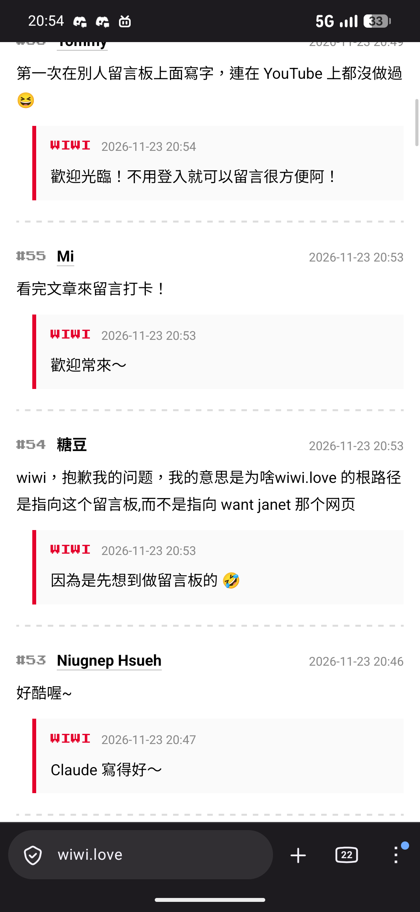

看到本文就代表 Wiwi 的[網域囤積症](https://wiwi.blog/blog/get-your-own-domain/#新年新門牌)又犯了。

他買了 [wiwi.love](https://wiwi.love)。

對我這窮學生是真的很難想像這玩意還能囤積，因為我都買不起。一般來講我要放新東西都是用子網域，比如 [Where is my Qiqi?](https://qiqi.niugnep.idv.tw)

坐等他買 `wiwi.dev` 取代 `code.wiwi.blog`（不對這玩意在 Porkbun 要一千多美金，好貴！）

話說原來是 Claude 嗎？XD

